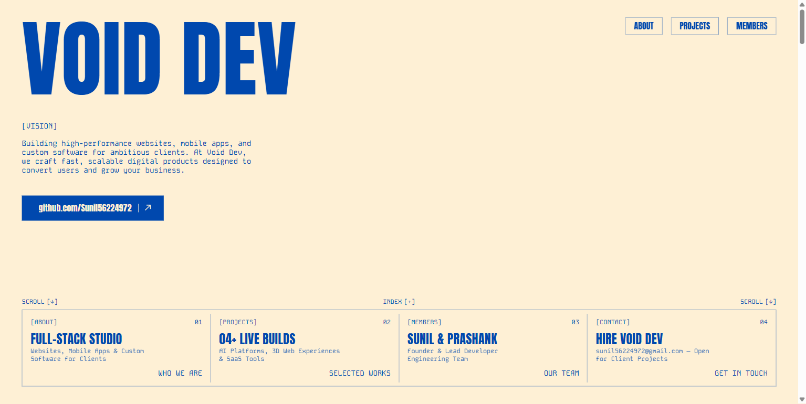
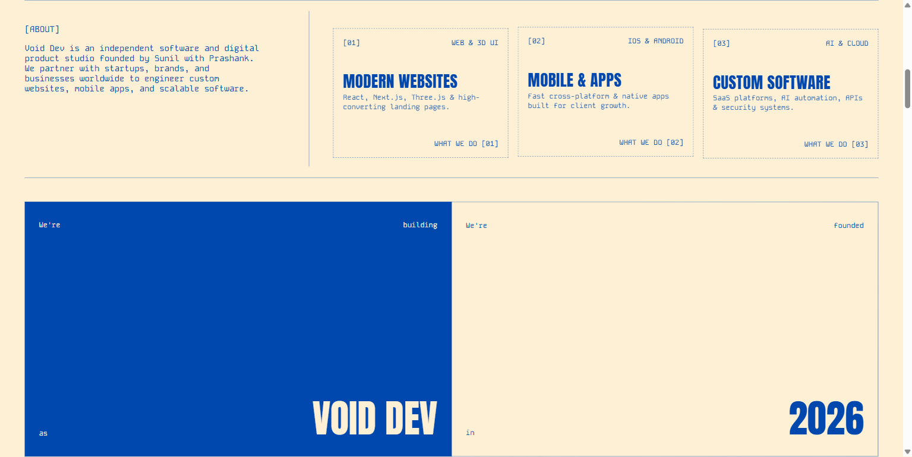
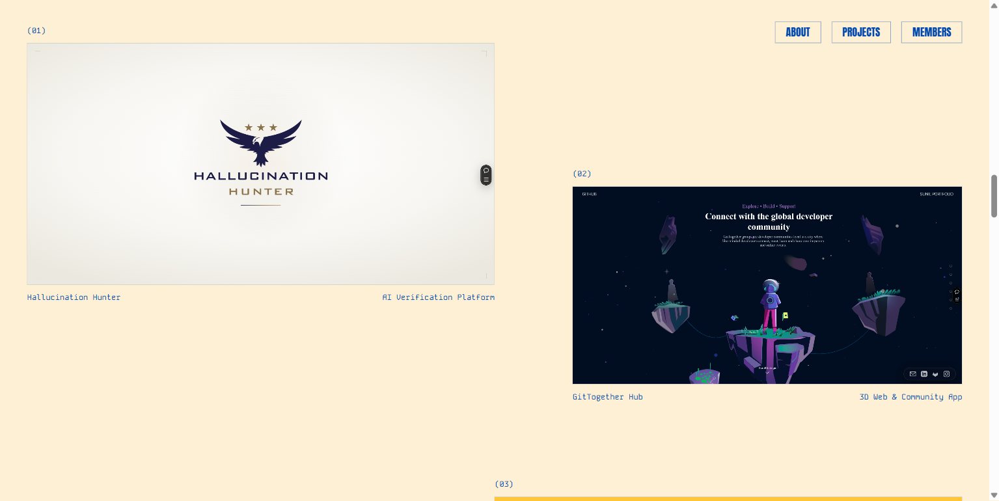

<div align="center">

# ⚡ VOID DEV

### Freelance Web, Mobile App & Custom Software Development Studio

[-0048AE?style=for-the-badge&logo=github)](https://github.com/Sunil56224972)
[](mailto:sunil56224972@gmail.com)
[](#contact)

**Building high-performance websites, mobile applications, and custom software for ambitious clients worldwide.**



</div>

---

## 🚀 Overview

**VOID DEV** is an independent software and digital product studio founded by **Sunil** with **Prashank**. We partner with startups, brands, and businesses to design and engineer fast, scalable digital products crafted to convert users, automate workflows, and accelerate business growth.



---

## 🛠️ What We Do

| Pillar | Capabilities | Key Deliverables |
| :--- | :--- | :--- |
| **[01] Modern Websites** | Full-Stack Web & 3D Interactive UI | • Custom Websites & High-Converting Landing Pages<br>• Full-Stack Web Applications (`React`, `Next.js`, `Three.js`)<br>• 3D Interactive (`WebGL`) & E-Commerce Sites |
| **[02] Mobile & Apps** | iOS, Android & Cross-Platform | • Native & Cross-Platform Mobile Apps<br>• UI/UX Product Design & Interactive Prototyping<br>• Real-Time Backend & API Integrations |
| **[03] Custom Software** | SaaS, AI Automation & Security | • Custom SaaS & Enterprise Business Software<br>• AI Agents, Automation Pipelines & LLM Integrations<br>• Codebase Audits, Security & Cloud Architecture |

---

## 🏆 Selected Works



| # | Project | Category | Highlights |
| :-: | :--- | :--- | :--- |
| **(01)** | **Hallucination Hunter** | `AI Verification Platform` | Claim-by-claim AI verification & fact-checking platform with web console, MCP server, and browser extension. |
| **(02)** | **GitTogether Hub** | `3D Web & Community App` | Immersive 3D spatial developer community and portfolio experience built with smooth scroll and interactive graphics. |
| **(03)** | **Planetoño — Galaxy Bite** | `Interactive Brand Website` | High-energy interactive 3D food brand and e-commerce web experience with custom motion design. |
| **(04)** | **Audit-X** | `Codebase Analysis SaaS` | Developer SaaS platform that visualizes dependency bloat, testing gaps, and execution lag in a cinematic report. |

---

## 👥 Our Team

- **`/001` Sunil — Founder** ([@Sunil56224972](https://github.com/Sunil56224972))
  *Leads Void Dev with a focus on full-stack web applications, custom software architecture, security engineering, and client products.*
- **`/002` Prashank — Lead Developer**
  *Develops mobile applications, scalable backend systems, and seamless user experiences for client projects.*

---

## 📂 Project Structure

```text
Void-Dev/
├── assets/
│   ├── css/
│   │   └── style.css          # VOID DEV studio stylesheet & responsive grid system
│   ├── js/
│   │   └── main.js            # Motion, Lenis smooth scroll & Canvas pixelation engine
│   └── img/
│       ├── favicon.svg        # VOID DEV monogram vector icon
│       ├── arrow.svg          # Interactive directional arrow icon
│       ├── project-01.png     # Hallucination Hunter showcase
│       ├── project-02.png     # GitTogether Hub showcase
│       ├── project-03.png     # Planetoño — Galaxy Bite showcase
│       └── project-04.png     # Audit-X showcase
├── index.html                 # Main studio entry point
├── server.js                  # Zero-dependency Node.js development server
└── package.json               # Project metadata & scripts
```

---

## 💻 Quick Start

### 1. Clone the repository
```bash
git clone https://github.com/Sunil56224972/Void-Dev.git
cd Void-Dev
```

### 2. Run the local server
```bash
npm start
# or directly:
node server.js
```
The studio site will launch automatically at **[http://localhost:3000](http://localhost:3000)**.

---

## 📬 Contact & Inquiries

Have a website, mobile app, or custom software project in mind? Let's build together:

- **Email**: [sunil56224972@gmail.com](mailto:sunil56224972@gmail.com)
- **GitHub**: [github.com/Sunil56224972](https://github.com/Sunil56224972)
- **Location**: Kawardha / Raipur, Chhattisgarh, India (Available Worldwide)

---

<div align="center">
  <sub>© 2026 <strong>VOID DEV</strong> • Founded &amp; Engineered by <a href="https://github.com/Sunil56224972">Sunil</a> &amp; Prashank</sub>
</div>
